# Results

_Written by `scripts/build_report.py` from the JSON files in `results/`. Edit the script, not this file._

## How GPT-2 tokenises financial text

| Corpus | Tokens / word | Chars / token | Words split into 2+ tokens |
|---|---|---|---|
| General English (The Verdict) | 1.37 | 3.98 | 25.1% |
| PhraseBank sentences | 1.23 | 4.49 | 13.6% |
| News headlines | 1.55 | 3.97 | 35.8% |

A word-level vocabulary built on general English maps 53.8% of PhraseBank tokens to `<|unk|>`; one built on PhraseBank still loses 40.2% of headline tokens. BPE never fails, but it fragments finance vocabulary: `EBITDA` → 3, `EPS` → 1, `y/y` → 3, `bps` → 2, `guidance` → 1, `dividend` → 1, `buyback` → 2, `downgrade` → 1, `AAPL` → 2, `NVDA` → 2.

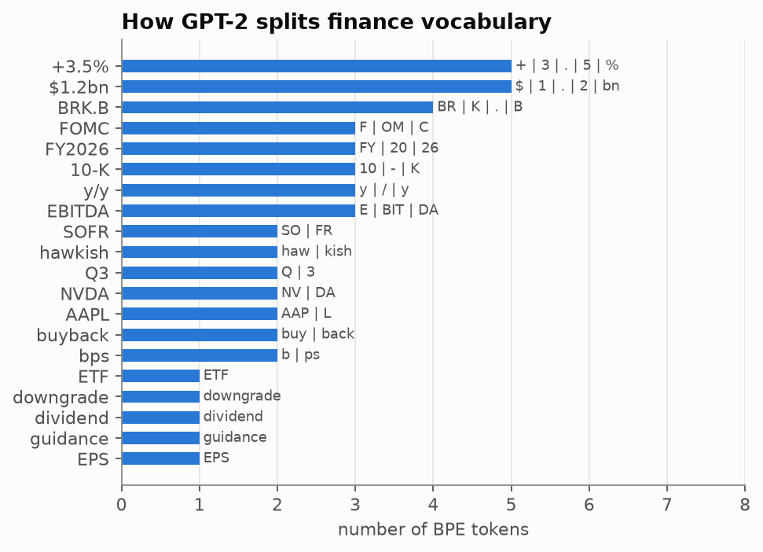

## Attention: correctness and cost

Device: NVIDIA GeForce RTX 3060 Laptop GPU (6.0 GB). Explicit attention equals PyTorch's fused kernel to 3.6e-07; editing future tokens changes past outputs by 0.0e+00 (no look-ahead).

| T | explicit ms | fused ms | explicit peak MB | fused peak MB |
|---|---|---|---|---|
| 128 | 2.73 | 2.29 | 133 | 135 |
| 256 | 5.86 | 4.45 | 213 | 163 |
| 512 | 16.24 | 10.51 | 528 | 225 |
| 1024 | 50.87 | 27.52 | 1734 | 351 |

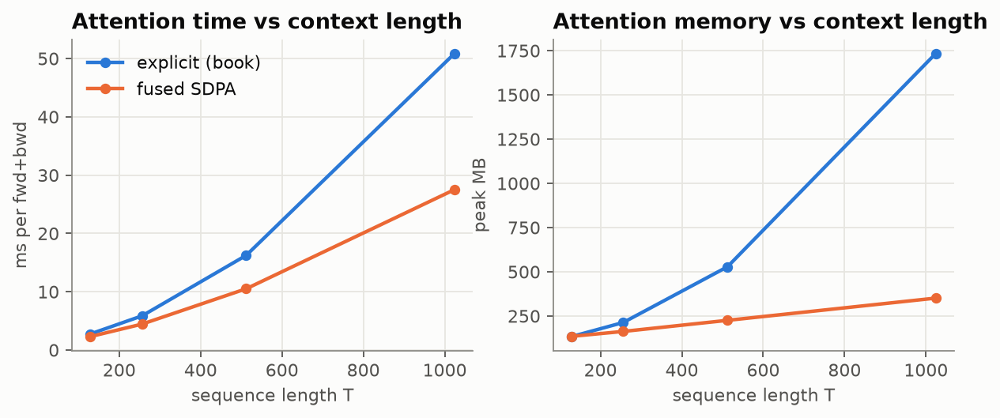

## Model size and what fits on a 6 GB GPU

| Model | Parameters | fp32 weights (GB) | AdamW training state (GB) |
|---|---|---|---|
| gpt2-small (124M) | 124,439,808 | 0.46 | 1.9 |
| gpt2-medium (355M) | 354,823,168 | 1.32 | 5.3 |
| gpt2-large (774M) | 774,030,080 | 2.88 | 11.5 |
| gpt2-xl (1558M) | 1,557,611,200 | 5.80 | 23.2 |

Measured on **NVIDIA GeForce RTX 3060 Laptop GPU (6.0 GB)** (sequence length 256, one AdamW step). Runs that needed more than 6 GB did not crash: Windows spilled them into system RAM, e.g. gpt2-medium (355M) at batch 8 needed 11.8 GB and managed only 187 tokens/s.

| Model | Attention | Precision | Largest batch within 6 GB | Tokens/s |
|---|---|---|---|---|
| gpt2-medium (355M) | explicit | bf16 | none | – |
| gpt2-medium (355M) | explicit | fp32 | none | – |
| gpt2-medium (355M) | fused | bf16 | none | – |
| gpt2-medium (355M) | fused | fp32 | none | – |
| gpt2-small (124M) | explicit | bf16 | 8 | 8,877 |
| gpt2-small (124M) | explicit | fp32 | 8 | 2,792 |
| gpt2-small (124M) | fused | bf16 | 8 | 9,869 |
| gpt2-small (124M) | fused | fp32 | 8 | 6,116 |

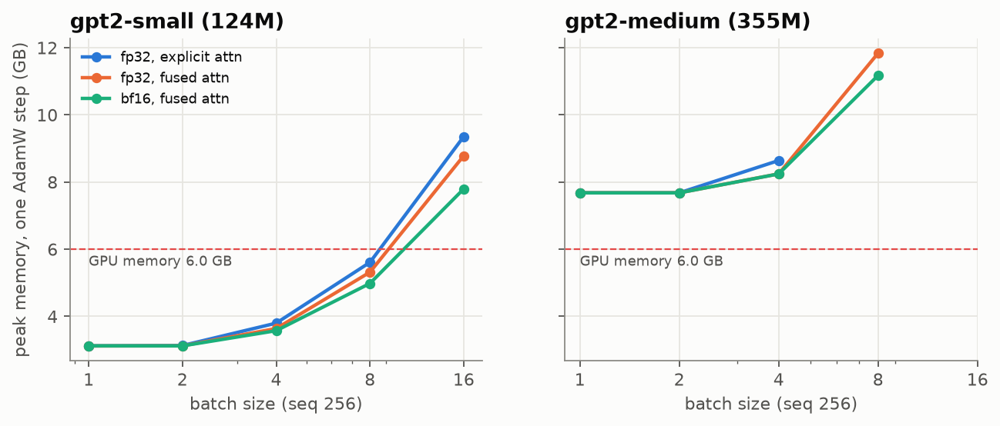

## Pretraining, the domain gap and domain adaptation

A 49M-parameter GPT trained from scratch on 1,699,738 tokens of headlines (≤ 2014-03-23) in 3.3 min reaches validation perplexity **25.9**, against **829.7** for a word-frequency baseline. Samples: _“Oil prices, 2012 - Corporate Summary”_; _“Tesla stock falls as Stocks to Watch: AAPL, CSC, OXY, TIF, PNC”_

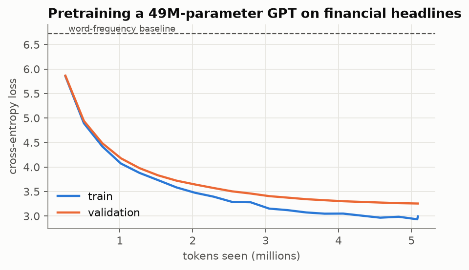

OpenAI's GPT-2 weights loaded into this code, perplexity by domain (256-token windows):

| Model | General English (The Verdict) | Financial PhraseBank (test) | News headlines (out-of-sample window) |
|---|---|---|---|
| gpt2-small (124M) | 41.9 | 138.7 | 604.1 |
| gpt2-medium (355M) | 32.8 | 110.6 | 387.3 |

Greedy sample (gpt2-medium (355M)): _“The Federal Reserve said on Wednesday that it would begin raising interest rates in December, but it has not yet set a date for when it will begin to raise rates”_

Attention sink: averaged over heads, layers 2–12 put 36%–85% of attention on the first token.

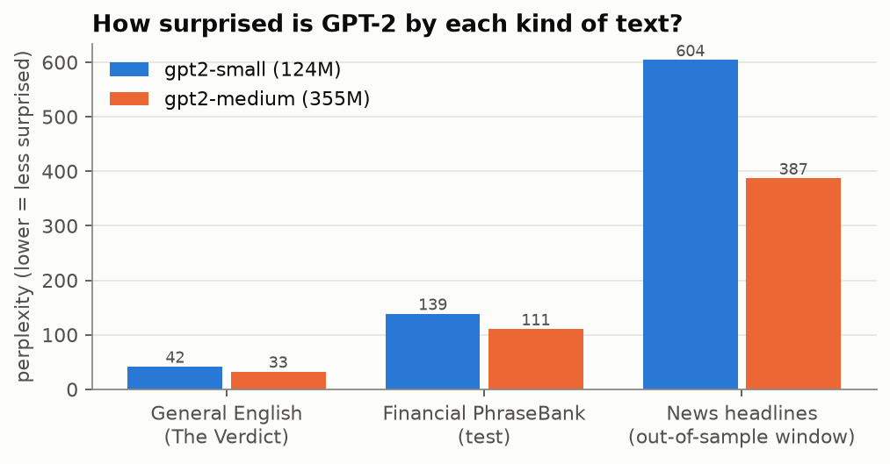

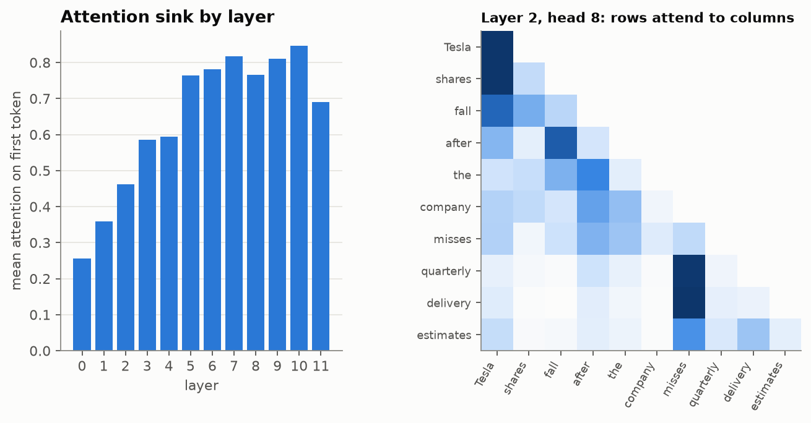

Domain-adaptive pretraining (12.3M tokens, 23 min)

| Corpus | GPT-2 | GPT-2 + DAPT | Change |
|---|---|---|---|
| General English (The Verdict) | 41.9 | 172.4 | +311.3% |
| Financial PhraseBank (test) | 138.7 | 660.6 | +376.2% |
| News headlines (out-of-sample window) | 604.1 | 149.7 | -75.2% |

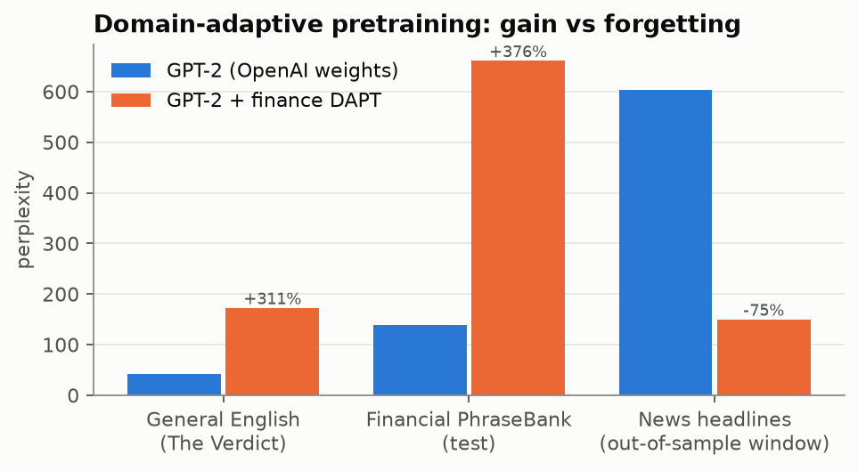

## Financial sentiment classifier

Test set: 968 PhraseBank sentences (never used for training or model selection). The model in bold was picked on validation macro-F1.

| Model | Accuracy | Macro-F1 | 95% CI | Δ macro-F1 vs TF-IDF [95% CI] | McNemar p |
|---|---|---|---|---|---|
| Majority class | 0.594 | 0.248 | [0.240, 0.256] | – | – |
| TF-IDF + LogReg | 0.793 | 0.748 | [0.714, 0.780] | – | – |
| GPT-2 small (last block) | 0.848 | 0.821 | [0.792, 0.848] | +0.073 [0.041, 0.108] | < 0.0001 |
| GPT-2 small (all) | 0.860 | 0.845 | [0.818, 0.871] | +0.098 [0.063, 0.132] | < 0.0001 |
| **GPT-2 small + DAPT (all)** | 0.867 | 0.847 | [0.820, 0.873] | +0.100 [0.065, 0.135] | < 0.0001 |
| GPT-2 medium (last block) | 0.839 | 0.806 | [0.776, 0.834] | +0.059 [0.023, 0.095] | 0.0013 |

Accuracy of the selected model by annotator agreement: 50% agreement: 0.675 (n=123), 66% agreement: 0.778 (n=158), 75% agreement: 0.848 (n=237), 100% agreement: 0.960 (n=450). Domain pretraining before fine-tuning changed test macro-F1 by +0.002 (0.845 → 0.847); the confidence intervals overlap almost completely.

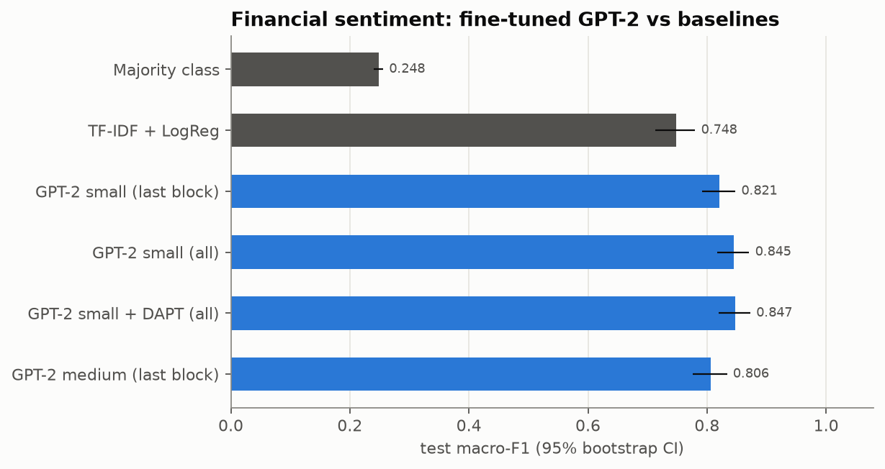

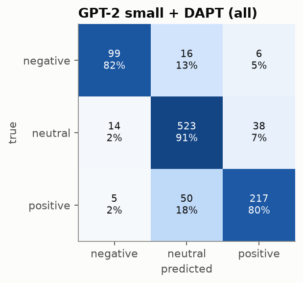

## Instruction-tuned finance assistant

gpt2-medium (355M), 8,000 training examples, 13 min. LoRA rank 16: 7,077,888 trainable parameters (1.71% of 413,364,224). Peak GPU memory 5.1 GB. 

Same PhraseBank test set as the sentiment classifier, answered in free text:

| Model | Accuracy | Macro-F1 | Unparseable answers |
|---|---|---|---|
| Base model, zero-shot | 0.001 | 0.001 | 99.7% |
| After instruction tuning | 0.840 | 0.826 | 0.0% |
| Sentiment classifier (GPT-2 small + DAPT (all)) | 0.867 | 0.847 | 0.0% |

- “As a result of the cancellation , the maximum increase of Citycon 's share capital on the basis of the convert” → **negative** (label: neutral)
- “Precedex is approved for IV sedation of initially intubated and mechanically ventilated patients in intensive ” → **neutral** (label: positive)
- “Currently more than 100 of Global Fortune 500 companies are using SSH security solutions .” → **neutral** (label: neutral)

Free-form finance answers are in [`results/instruction_responses.json`](../results/instruction_responses.json).

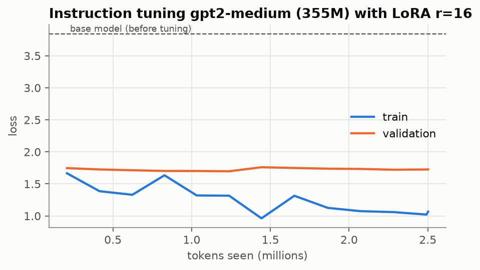

## Backtest: sentiment as a trading signal

In-sample 2014-03-23 → 2017-04-28, out-of-sample 2017-04-28 → 2020-06-04. 478,528 headlines on 750 stocks scored with GPT-2 small + DAPT (all) (3,026 headlines/s). Price coverage 66% of headlines. Rules: enter at the open after the news date, hold one day, ±0.25 score threshold, ≥3 names per side, price ≥ $5, 10 bps per side.

| Signal | Period | Net Sharpe [95% CI] | Gross Sharpe | Net ann. return | Max DD | IC next day (NW t) | IC same day (NW t) | Permutation p | Daily turnover | Break-even cost (bps/side) |
|---|---|---|---|---|---|---|---|---|---|---|
| GPT-2 classifier | in-sample | -5.12 [-6.31, -4.14] | -0.32 | -37.2% | 76.4% | +0.0023 (t=0.6) | +0.0363 (t=6.9) | 0.762 | 1.71 | -0.7 |
| GPT-2 classifier | out-of-sample | -5.62 [-7.10, -4.26] | 0.62 | -33.6% | 72.0% | +0.0081 (t=2.0) | +0.0352 (t=9.5) | 0.104 | 1.79 | 1.0 |
| TF-IDF + LogReg | in-sample | -2.51 [-3.70, -1.41] | 0.13 | -20.5% | 51.5% | -0.0013 (t=-0.3) | +0.0331 (t=7.2) | 0.389 | 0.94 | 0.5 |
| TF-IDF + LogReg | out-of-sample | -3.22 [-4.83, -1.89] | -0.28 | -25.1% | 60.9% | +0.0042 (t=1.2) | +0.0289 (t=7.0) | 0.760 | 1.03 | -0.9 |

Caveats: Prices from Yahoo Finance: delisted companies are missing (survivorship bias). Headline timestamps are dates only; entry is delayed to the next open to stay safe. Partner-site headlines are not a complete news feed; coverage varies by stock and year. Costs are a flat bps charge; no market impact or borrow fees for shorts.

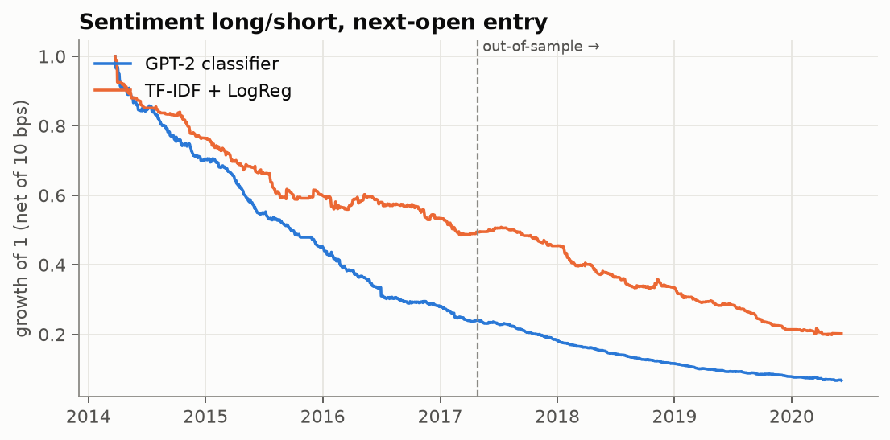

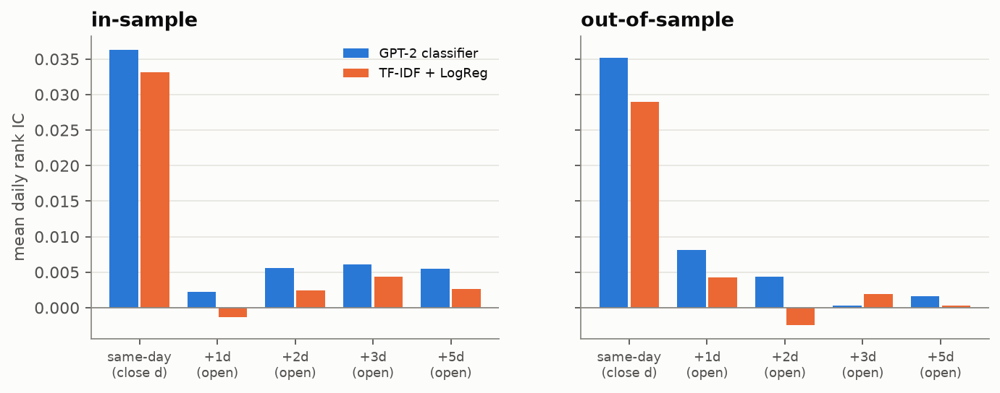

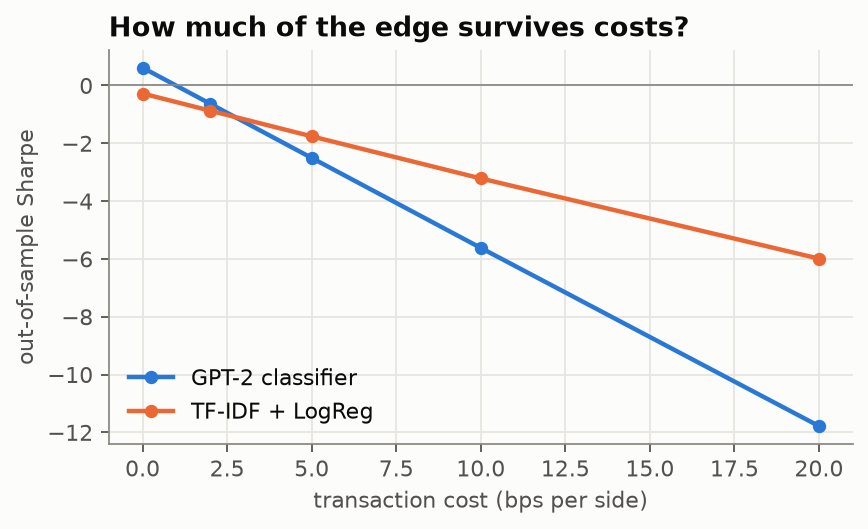

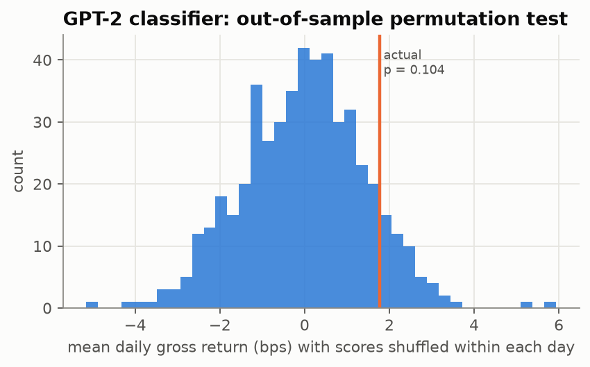
